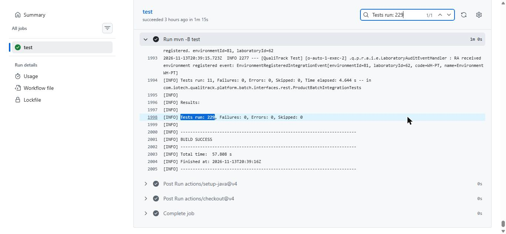
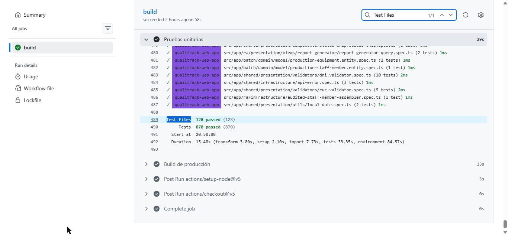
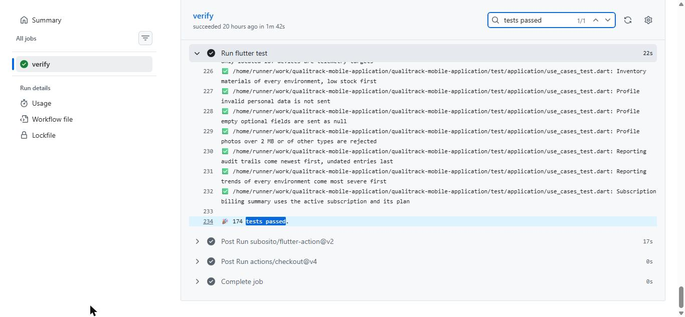
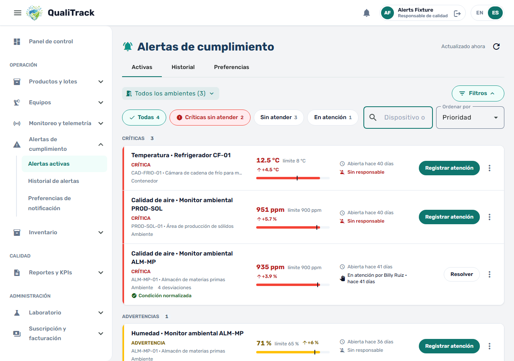
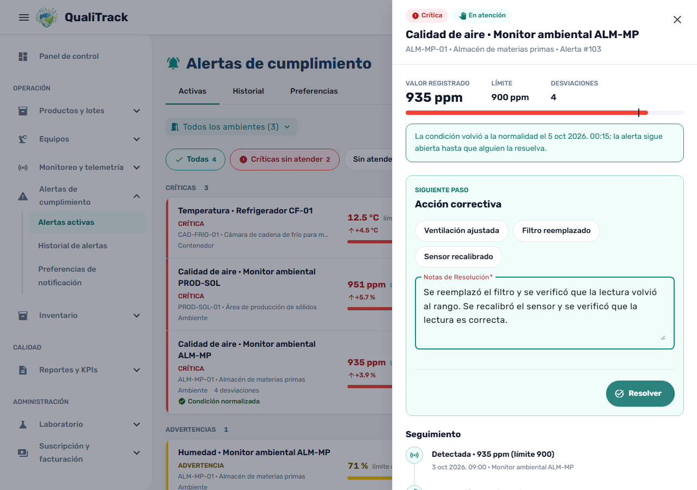
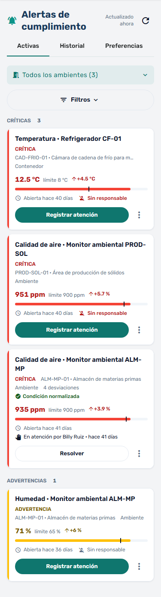

# Capítulo VI: Product Verification & Validation

### 6.1. Testing Suites & Validation

<p>
En esta sección se presentan las suites de pruebas automatizadas elaboradas por el equipo IoTech para verificar el
correcto funcionamiento de QualiTrack. Cada producto de código cuenta con su propia suite, que se ejecuta en GitHub
Actions en cada Pull Request hacia <code>develop</code> y <code>main</code> (sección 7.1), de modo que ningún cambio se
integra si alguna prueba falla. Al 13/11/2026 las tres suites se encuentran aprobadas:
</p>

| Producto | Repositorio | Herramientas | Archivos de prueba | Pruebas ejecutadas en CI |
|---|---|---|---|---:|
| Backend Web Services (RESTful API) | [Qualitrack-Platform](https://github.com/Experimentos-1ASI0732-2620-9104/Qualitrack-Platform/tree/develop/src/test/java/com/iotech/qualitrack/platform) | JUnit 5, Spring Boot Test, MockMvc | 44 clases | 229 |
| Frontend Web Application | [Qualitrack-WebApplication](https://github.com/Experimentos-1ASI0732-2620-9104/Qualitrack-WebApplication/tree/develop/src/app) | Vitest con Angular TestBed | 128 archivos `.spec.ts` | 870 |
| Mobile Application | [Qualitrack-MobileApplication](https://github.com/Experimentos-1ASI0732-2620-9104/Qualitrack-MobileApplication/tree/develop/test) | flutter_test, bloc_test | 18 archivos | 174 |

<p>
Las herramientas de prueba utilizadas son las siguientes:
</p>

| Herramienta | Producto | Uso dentro de la suite |
|---|---|---|
| JUnit 5 (Jupiter) | Backend | Framework base para definir y ejecutar los casos de prueba, incluidas las pruebas parametrizadas. |
| Spring Boot Test + MockMvc | Backend | Levanta el contexto de Spring y ejercita los endpoints REST sobre una base de datos de prueba, comprobando códigos HTTP, recursos devueltos y permisos por rol. |
| Maven Surefire | Backend | Ejecución automatizada de las pruebas con <code>mvn -B test</code>. |
| Vitest + Angular TestBed | Web | Pruebas de assemblers, servicios, stores, validadores y componentes de cada Bounded Context (<code>ng test</code>). |
| Playwright (Chromium) | Web | Scripts de navegador en <code>tests/*.mjs</code> que recorren las vistas principales (sección 6.1.4). |
| flutter_test + bloc_test | Mobile | Pruebas del dominio, casos de uso, infraestructura HTTP, BLoC, pantallas y reglas de dependencia entre capas (<code>flutter test</code>). |

#### 6.1.1. Core Entities Unit Tests

<p>
Las pruebas unitarias validan, de forma aislada y sin levantar Spring ni la base de datos, las reglas del dominio de
cada Bounded Context: aggregates, entities, value objects y commands. Cada prueba sigue el patrón
<em>Arrange - Act - Assert</em>: se construye la entidad o el command, se ejecuta el comportamiento del dominio y se
verifica el estado resultante o la excepción esperada.
</p>

<p>
<strong>Backend (Qualitrack-Platform).</strong> Las pruebas se organizan por Bounded Context y capa dentro de
<code>src/test/java/com/iotech/qualitrack/platform/</code>. La siguiente tabla relaciona cada clase de prueba unitaria
con los comportamientos que verifica (25 clases, 131 métodos de prueba):
</p>

| Clase de prueba | Bounded Context | Comportamientos verificados (métodos de prueba) |
|---|---|---|
| `BatchCommandTests` | Product Batch Management | new batches are trimmed and counted in units by default; new batches need their place a number a positive quantity and an iso start date; releases and rejections need an iso date and their text (3) |
| `BatchLifecycleTests` | Product Batch Management | the first raw material consumption starts a pending batch; closed batches are not started again; new batches start pending with the product of their environment; (+3 más) (6) |
| `ComplianceScopeTests` | Compliance & Alerting | matching numeric ids do not mix events from different resource types (1) |
| `CaCommandServiceImplTest` | Compliance & Alerting | a first deviation opens a new alert; a worse deviation escalates the open alert; a repeated deviation is recorded without publishing events; (+4 más) (7) |
| `NotificationDomainTests` | Compliance & Alerting | preferences decide which notices reach the bell and the email; a notification is read once and alert notices carry their severity (2) |
| `AlertLifecycleCommandsTest` | Compliance & Alerting | acknowledge requires alert and user; resolve requires notes; condition normalized uppercases the parameter; (+3 más) (6) |
| `CreateDeviationAlertCommandTest` | Compliance & Alerting | normalizes parameter name and unit; accepts a missing device to use the environmental device; rejects missing or invalid identifiers; (+4 más) (7) |
| `EquipmentDomainTests` | Equipment Management | iot device is an equipment with type and identity; equipment is located only in environments of its laboratory; status change keeps the history and rejects the current status (3) |
| `EdgeGatewayAllocationTests` | Equipment Management | environment without gateways leaves every device uncovered; one gateway serves up to fifteen devices; devices beyond the capacity of the only gateway are uncovered; (+5 más) (8) |
| `AccountRecoveryDomainTests` | Identity & Access Management | the code expires after fifteen minutes and is used once; five wrong codes revoke the recovery; a new code waits one minute and replaces the previous one; (+3 más) (6) |
| `InventoryDomainTests` | Inventory Management | receipt requires review and preserves received quantity after consumption; rejects overdraft without changing stock; rejects different units without conversion; (+12 más) (15) |
| `EnvironmentDomainTests` | Laboratory Management | registration normalizes code and starts without usage; registration rejects missing or oversized data; usage can change but not be reassigned to the same value; (+1 más) (4) |
| `ProfileDomainTests` | Profile Management | personal data is validated and blank optional values are cleared; the profile tells when the name changed; only real images up to two megabytes are accepted as photos (3) |
| `ReportingTests` | Reporting & Audit | empty repository produces no invented metric or health score; counts use only the requested laboratory records; unresolved alerts are counted only for the equipment of the laboratory; (+5 más) (8) |
| `BatchReportPdfTests` | Reporting & Audit | empty deviations produce a short record without fabricated scores; included alerts produce counts charts and traceable details; excluded alerts are not leaked into summary or details; (+1 más) (4) |
| `PeriodReportTests` | Reporting & Audit | environmental pdf shows indicators alerts actions and method; inventory pdf shows stock lots expiration and containers; inventory csv has one column per value; (+5 más) (8) |
| `StockUnitTests` | Shared | accepts unit aliases but never implicitly converts mass to volume; registration does not round stock or allow fractional countable units (2) |
| `ErrorMessageLocalizationTests` | Shared | spanish requests receive the general message in spanish and keep the details; english requests keep the message of the error even on a spanish machine (2) |
| `StripeWebhookTests` | Payments & Subscriptions | unpaid checkout never grants access; paid checkout waits for active stripe subscription; active paid checkout persists subscription and payment without laboratory; (+9 más) (12) |
| `SubscriptionPaymentRecordingTests` | Payments & Subscriptions | a payment needs a checkout session or a provider payment; a renewal is recorded next to the other payments without checkout session; the same invoice is not recorded twice (3) |
| `SubscriptionAccessTests` | Payments & Subscriptions | active future period allows access before laboratory creation; expired or unknown periods never grant access; cancelled or unpaid subscription does not grant access; (+3 más) (6) |
| `SubscriptionPlanTests` | Payments & Subscriptions | preserves finite equipment allowances; represents unlimited equipment without an invented numeric limit; rejects negative equipment limits; (+2 más) (5) |
| `StripeWebhookControllerTests` | Payments & Subscriptions | paid invoice records the renewal; events without a valid signature are refused (2) |
| `TrackingQueryTests` | Tracking & Telemetry | an action of the device also counts as communication; device requires review when silent for longer than the expected period (2) |
| `EnvironmentalProfileTests` | Tracking & Telemetry | a value is normal inside the normal range warning up to the critical limits and critical beyond; contradictory or incomplete limits are rejected; an environment only configures the metrics of its environmental device; (+3 más) (6) |

<p>
<strong>Frontend Web Application (Qualitrack-WebApplication).</strong> Las pruebas de Vitest se agrupan por Bounded
Context, siguiendo la estructura de carpetas de la aplicación:
</p>

| Bounded Context | Archivos | Pruebas | Comportamientos verificados (ejemplos) |
|---|---:|---:|---|
| Compliance & Alerting | 19 | 180 | joins the open alerts of every environment; reads only the chosen environment; names the environment that failed without hiding the alerts of the others; (+177 más) |
| Shared | 26 | 118 | reads the status of the errors of the API endpoints; reads the status of the HTTP errors, 0 when the server could not be reached; returns null for errors that did not come from a request; (+115 más) |
| Inventory Management | 23 | 72 | warns for observed and rejected receipts and deduplicates production batches; removes the warning when the receipt is released and retains unlinked legacy consumption; keeps an empty material with historical consumption, labels and unrecorded balances; (+69 más) |
| Reporting & Audit | 13 | 52 | sorts activity newest first without mutating the API result; cancels stale activity and clears previous data when the staff changes; shows an error without retaining another staff member on failure; (+49 más) |
| Product Batch Management | 17 | 48 | tells process equipment from IoT devices; is usable only while it is operational; can be assigned to a batch while active, with an account and not an auditor; (+45 más) |
| Payments & Subscriptions | 4 | 26 | asks nothing when no plan was chosen; finds the switch to another plan, and spends the choice; takes the same plan with another billing cycle as a different plan; (+23 más) |
| Equipment Management | 7 | 14 | accepts valid data, including negative limits; does not send a range where the minimum is not lower than the maximum; sends a valid configuration; (+11 más) |
| Profile Management | 3 | 13 | shows the initials and full name when the profile has no photo; shows the photo instead of the initials when one is available; opens and loads the profile when onboarding becomes ready; (+10 más) |
| Tracking & Telemetry | 4 | 13 | follows only environmental devices and container monitors; translates the equipment into a device of Tracking; retains failed actuation events and the unfiltered period query; (+10 más) |
| Identity & Access Management | 5 | 12 | opens the page to visitors; sends whoever already has a session to the dashboard, instead of offering to sign in; sends visitors to sign in, remembering where they were going; (+9 más) |
| Laboratory Management | 5 | 9 | redirects the old material URL to Inventory while preserving the identifier; offers the quality manager the edition and the usage of each environment; lets the other roles only consult the environments; (+6 más) |
| Rutas de la aplicación | 2 | 7 | keeps the plan of the link even when the visitor is already signed in and is sent to the dashboard; keeps the plan of the link for a visitor who stays on the sign-up page; keeps the plan of a link followed from another page of IAM; (+4 más) |

<p>
<strong>Mobile Application (Qualitrack-MobileApplication).</strong> Las pruebas siguen las capas de la aplicación
Flutter; la prueba de arquitectura verifica que cada Bounded Context solo se comunique con otro a través de su API:
</p>

| Archivo de prueba | Capa | Comportamientos verificados (pruebas) |
|---|---|---|
| `application/use_cases_test.dart` | application | sign in trims the username and stores the session; sign in rejects empty credentials without calling the backend; restore clears an expired session; (+22 más) (25) |
| `architecture/architecture_test.dart` | architecture | the layer rules hold in lib/; rejects what the guide forbids; accepts what the guide allows (3) |
| `domain/batch_decision_day_test.dart` | domain | a decision cannot be dated before the batch started; a batch that starts later can still be decided today; without a start date the calendar goes back five years (3) |
| `domain/domain_test.dart` | domain | reads exp claim and detects expiration; malformed token has no expiration but empty token is expired; parses every backend role, including the auditor; (+27 más) (30) |
| `infrastructure/infrastructure_test.dart` | infrastructure | normalizes the base url to /api/v1; maps HTTP statuses and QualiTrack ErrorResource; detects onboarding requirement, including the password change; (+17 más) (20) |
| `presentation/batch_detail_test.dart` | presentation | quality managers decide from a fixed bar while the batch awaits review; no decision bar once the batch is released; other roles read the batch without the decision bar (3) |
| `presentation/batch_history_test.dart` | presentation | reads the name and values of an event recorded by the backend; ignores text with another shape; joins the audit log and the compliance events, newest first, each decision once; (+3 más) (6) |
| `presentation/batch_list_test.dart` | presentation | clearing the filters shows every batch and empties the search; the FAB menu filters by status and lists each count; the summary card shows the status in use and how many batches match; (+1 más) (4) |
| `presentation/bloc_test.dart` | presentation | no stored session → unauthenticated; ready onboarding → authenticated; temporary password → password change, then authenticated once changed; (+20 más) (23) |
| `presentation/equipment_list_test.dart` | presentation | filters through a FAB menu that fits a small phone; names an Edge Gateway instead of showing its type code; the Edge Gateways filter keeps only the gateways (3) |
| `presentation/inventory_screen_test.dart` | presentation | filters the stock through a FAB menu with a summary card (1) |
| `presentation/more_screen_test.dart` | presentation | groups the destinations in sections without overflow; hides the administration section from other roles; signs out with the profile button, only after confirming (3) |
| `presentation/navigation_test.dart` | presentation | the app router has the tabs by importance, alerts right after Home; each tab of the bar opens its own branch; content tabs keep where they were left; More always opens on its menu; (+1 más) (4) |
| `presentation/reports_bloc_test.dart` | presentation | a slow answer of the period picked before never replaces the period on screen; nor does its failure; the latest period is shown when its answer arrives last; (+1 más) (4) |
| `presentation/router_and_l10n_test.dart` | presentation | protected routes require a session; authenticated users leave public routes; a temporary password confines the user to the password change; (+6 más) (9) |
| `widget/home_layout_test.dart` | widget | Home shows the four cards on a without scrolling; the cards keep their own height and the latest alerts fill the rest; without open alerts the latest alerts are left out, not repeated; (+4 más) (7) |
| `widget/orientation_test.dart` | widget | only the screen inside LandscapeAllowed may turn, while it is the visible one; the app is laid out for portrait (2) |
| `widget/widgets_test.dart` | widget | validates required fields and has no sign-up entry; submits credentials and toggles password visibility; shows backend errors and is localized in Spanish; (+19 más) (22) |

#### 6.1.2. Core Integration Tests

<p>
Las pruebas de integración verifican que los módulos del backend funcionen correctamente al interactuar entre sí.
Cada prueba levanta el contexto de Spring Boot y ejercita los endpoints con MockMvc sobre una base de datos de prueba,
de modo que en un mismo flujo participan las capas <em>interfaces</em> (controllers y resources),
<em>application</em> (command y query services), <em>domain</em> e <em>infrastructure</em> (repositorios JPA), junto con
el filtro de seguridad JWT, los permisos por rol y el aislamiento por laboratorio (multi-tenant).
</p>

<p>
La siguiente tabla relaciona cada clase de prueba de integración con los comportamientos que verifica (19
clases, 90 métodos de prueba). En total la suite del backend tiene 221 métodos de prueba; con los casos de las
pruebas parametrizadas Maven ejecuta 229.
</p>

| Clase de prueba | Bounded Context | Comportamientos verificados (métodos de prueba) |
|---|---|---|
| `QualitrackPlatformApplicationTests` | Shared | context loads (1) |
| `StockRollbackTests` | Product Batch Management | a failed usage write rolls back the inventory consumption (1) |
| `ProductBatchIntegrationTests` | Product Batch Management | quality manager registers lists and reads products of an environment; product codes and names are unique in the laboratory only; only quality roles register products and other laboratories cannot read them; (+8 más) (11) |
| `ComplianceAlertsIntegrationTests` | Compliance & Alerting | an incident detected by tracking is one alert with its actions until it is resolved; deviations confirmed through the api open or join the alert of their device (2) |
| `EquipmentIntegrationTests` | Equipment Management | quality manager registers and lists equipment of the laboratory; equipment is located in an environment of the same laboratory; status changes are traceable and rejected when not allowed; (+7 más) (10) |
| `StaffCredentialsEmailTests` | Identity & Access Management | credentials are emailed to the staff member; a failed delivery leaves the temporary password for the quality manager (2) |
| `AccountRecoveryIntegrationTests` | Identity & Access Management | sign up requires a unique email; the password is reset with the code sent to the email; the answer does not reveal which accounts exist; (+3 más) (6) |
| `OnboardingIntegrationTests` | Identity & Access Management | account must pay then create laboratory and cannot create twice; expired and unverified subscriptions do not unlock the api; account cannot register in another laboratory or self assign administrator; (+11 más) (14) |
| `InventoryPersistenceTests` | Inventory Management | only quality reviewer in same laboratory can release; simultaneous retries record only one consumption; quarantine review consumption and affected batch history persist; (+7 más) (10) |
| `ContainerAssignmentIntegrationTests` | Inventory Management | raw material lots are stored in containers of their raw material storage environment; product batches are stored in containers of product storage environments (2) |
| `EnvironmentInventoryIntegrationTests` | Inventory Management | quality manager registers raw materials and reviews their lots; low stock and near expiry filters identify materials and lots; raw materials are scoped to their environment and laboratory; (+2 más) (5) |
| `EnvironmentIntegrationTests` | Laboratory Management | quality manager registers lists updates and classifies environments; environments of another laboratory are not available; laboratory operator can consult but not change environments (3) |
| `StaffAccountIntegrationTests` | Laboratory Management | registered staff signs in with temporary credentials and must change the password; only quality managers register staff and emails are unique; staff cannot manage the subscription and auditors only consult; (+2 más) (5) |
| `ProfileAndNotificationIntegrationTests` | Profile Management | each person keeps a profile that the quality manager sees in the staff list; a person changes the username and email of the account with the current password; the laboratory is notified of what others do with its alerts and batches (3) |
| `ReportingIndicatorsIntegrationTests` | Reporting & Audit | indicators summarize the readings of the period with time in range and deviations; the environmental report combines indicators alerts and actions of each environment; the inventory report lists raw materials lots and quantities; (+1 más) (4) |
| `OpenApiDocumentationTests` | Shared | groups every operation by the first segment after the api version (1) |
| `RestApiIntegrationTests` | Shared | alerts are acknowledged and resolved as sub resources by the authenticated user; bpm parameter ranges are resources of the equipment identified by their name; created laboratories and users answer with their location (3) |
| `SubscriptionPlanSeedIntegrationTests` | Payments & Subscriptions | startup creates the catalog plans only once; stored plans are not changed and a taken stripe price is not reused (2) |
| `TrackingIntegrationTests` | Tracking & Telemetry | a quality manager configures the air quality of an environment with its environmental device; a container monitor has thresholds and actuation rules that need them; readings are evaluated and the deviations of an incident share one alert; (+2 más) (5) |

<div align="center">
  
  <p><em>Figura: Ejecución de la suite de Qualitrack-Platform en GitHub Actions. El workflow de integración continua ejecuta con Maven las 229 pruebas unitarias y de integración, todas aprobadas.</em></p>
</div>

<div align="center">
  
  <p><em>Figura: Ejecución de la suite de Qualitrack-WebApplication en GitHub Actions. Se aprueban los 128 archivos y las 870 pruebas de Vitest antes de compilar la versión 2.5.0.</em></p>
</div>

<div align="center">
  
  <p><em>Figura: Ejecución de la suite de Qualitrack-MobileApplication en GitHub Actions. Se aprueban las 174 pruebas de Flutter después del análisis estático con flutter analyze.</em></p>
</div>

#### 6.1.3. Core Behavior-Driven Development

<p>
En este sprint no se elaboraron pruebas de aceptación BDD con archivos <code>.feature</code>; los escenarios de
aceptación de cada Technical Story se verifican con las pruebas de integración de su endpoint (sección 6.1.2). Por
ejemplo, el criterio de aceptación de la gestión de alertas (reconocer y resolver una alerta de desviación como el
usuario autenticado) se valida en <code>RestApiIntegrationTests</code> y <code>ComplianceAlertsIntegrationTests</code>, y
el de onboarding (pagar la suscripción antes de crear el laboratorio) en <code>OnboardingIntegrationTests</code>.
</p>

#### 6.1.4. Core System Tests

<p>
Las pruebas de sistema validan la Frontend Web Application como la usa el responsable de calidad: un navegador real
(Chromium, automatizado con <strong>Playwright</strong>) opera las vistas principales y verifica la navegación, los
formularios, las validaciones, los mensajes de error y el diseño responsive. Los scripts responden las llamadas al API
con fixtures, por lo que ninguna prueba llega a la plataforma real; se ejecutan con Node contra la aplicación en
ejecución (<code>ng serve</code>), por ejemplo <code>node tests/responsive.mjs</code>, y la variable
<code>WEB_URL</code> permite cambiar la dirección de la aplicación.
</p>

<p>
<strong>Ubicación:</strong> <code>tests/</code> (repositorio Qualitrack-WebApplication).
</p>

| Script | Vista validada |
|---|---|
| `alerts-browser.mjs` | Bandeja de alertas activas, grupos por severidad, panel de detalle, reconocimiento y resolución de alertas. |
| `dashboard-browser.mjs` | Dashboard: selección de telemetría, unidades, suscripción, idioma español y errores parciales del API. |
| `inventory-browser.mjs` | Inventario: catálogo, registro de materiales, validaciones, códigos rechazados y revisión de recepciones. |
| `onboarding-browser.mjs` | Onboarding del laboratorio después de la suscripción. |
| `report-generator-browser.mjs` | Generador de reportes: descargas, periodo inválido y reporte rechazado. |
| `responsive.mjs` | Diseño de las vistas principales en distintos anchos de pantalla. |
| `stripe-catalog-browser.mjs` | Catálogo de planes de Stripe; requiere un backend local aislado (<code>LOCAL_API=1</code>) porque crea cuentas reales. |

<p>
<strong>Alcance:</strong> estos scripts se ejecutan de forma local y no forman parte del pipeline de integración
continua, que ejecuta las pruebas unitarias de Vitest (sección 7.1). La aplicación móvil consume el mismo RESTful API,
cuyos flujos quedan cubiertos por las pruebas de integración del backend (6.1.2) y por las pruebas de pantallas y BLoC
de la propia aplicación (6.1.1).
</p>

<p>
<strong>Ejecución:</strong> se ejecutaron localmente <code>alerts-browser.mjs</code> y <code>responsive.mjs</code> en
Chromium contra la aplicación en <code>ng serve</code>. El primero verificó la bandeja de alertas activas, el panel de
detalle y la resolución de una alerta en anchos de 320 a 1440 px. El segundo revisó 33 vistas en 9 anchos de pantalla
(297 combinaciones) sin desbordes ni fallos.
</p>

```
$ node tests/alerts-browser.mjs
Alerts browser checks passed

$ node tests/responsive.mjs
Checked 33 views at 320px
...
Checked 33 views at 1440px
{
  "checked": 297,
  "failures": []
}
```

<div align="center">
  
  <p><em>Figura: Bandeja de alertas activas capturada por alerts-browser.mjs (1280 px), con el filtro de alertas críticas sin atender.</em></p>
</div>

<div align="center">
  
  <p><em>Figura: Panel de detalle de una alerta con la acción correctiva y las notas de resolución ingresadas por la prueba.</em></p>
</div>

<div align="center">
  
  <p><em>Figura: La misma bandeja en un ancho de 375 px, verificada por la prueba sin desbordes.</em></p>
</div>

<p>
<strong>Commits relacionados con testing (52):</strong>
</p>

| Repository | Branch | Commit Id | Commit Message | Committed on (Date) |
|---|---|---|---|---|
| Experimentos-1ASI0732-2620-9104/Qualitrack-WebApplication | feature/dependencies | 6367f98 | fix(i18n): provide the translate service in the component specs | 27/10/2026 |
| Experimentos-1ASI0732-2620-9104/Qualitrack-WebApplication | feature/ci-unit-tests | 50cce4c | ci: run the unit tests in the pull request build | 27/10/2026 |
| Experimentos-1ASI0732-2620-9104/Qualitrack-WebApplication | feature/semantic-routes | c4dbf9a | test(routes): cover the redirects from view-named paths to semantic routes | 30/10/2026 |
| Experimentos-1ASI0732-2620-9104/Qualitrack-WebApplication | feature/semantic-routes | 6b4629c | test(routes): cover the redirects from view-named paths to semantic routes | 30/10/2026 |
| Experimentos-1ASI0732-2620-9104/Qualitrack-WebApplication | develop | a6edba8 | refactor(report-generator): remove unused card components and spec | 01/11/2026 |
| Experimentos-1ASI0732-2620-9104/Qualitrack-WebApplication | develop | 34fa0bd | test(ca): add browser checks of the active alerts | 03/11/2026 |
| Experimentos-1ASI0732-2620-9104/Qualitrack-WebApplication | develop | 43556b6 | test(ca): add browser checks of the detail panel | 03/11/2026 |
| Experimentos-1ASI0732-2620-9104/Qualitrack-WebApplication | fix/session-and-pending | 6c7831a | test(e2e): bring the browser checks up to the current screens | 04/11/2026 |
| Experimentos-1ASI0732-2620-9104/Qualitrack-WebApplication | fix/refactor-views-review | d24242f | test: update the specs of the views that gained a link and an icon | 04/11/2026 |
| Experimentos-1ASI0732-2620-9104/Qualitrack-WebApplication | fix/inventory-review | b0ccf30 | test(inventory): cover the components of the views and the corrections of the store | 05/11/2026 |
| Experimentos-1ASI0732-2620-9104/Qualitrack-WebApplication | fix/batch-inventory-review | a4add6a | test(inventory): cover the request guards, the reload and the catalogue stats | 08/11/2026 |
| Experimentos-1ASI0732-2620-9104/Qualitrack-WebApplication | feature/inventory | 1eb4f2d | test(inventory): update catalogue tests for tab navigation | 11/11/2026 |
| Experimentos-1ASI0732-2620-9104/Qualitrack-WebApplication | feature/refactor-ui | 1b7cd78 | test(ca): update the alerts browser test to the redesigned module | 12/11/2026 |
| Experimentos-1ASI0732-2620-9104/Qualitrack-WebApplication | feature/refactor-ui | 5bec886 | test(reports): provide the router to the audit log viewer spec | 12/11/2026 |
| Experimentos-1ASI0732-2620-9104/Qualitrack-WebApplication | fix/develop-review | 768fa97 | test: follow the Register button of the material form and say how to run the alerts checks | 13/11/2026 |
| Experimentos-1ASI0732-2620-9104/Qualitrack-Platform | feature/ca | c348649 | test(ca): cover deviation alert command handling | 30/10/2026 |
| Experimentos-1ASI0732-2620-9104/Qualitrack-Platform | feature/ca | b3b98e8 | test(ca): add test AlertLifecycle | 30/10/2026 |
| Experimentos-1ASI0732-2620-9104/Qualitrack-Platform | feature/ca | bd451f6 | test(ca): add test from deviation alert | 30/10/2026 |
| Experimentos-1ASI0732-2620-9104/Qualitrack-Platform | feature/ddd-tests-by-package | 074bd9c | test: organize the tests by bounded context and layer | 02/11/2026 |
| Experimentos-1ASI0732-2620-9104/Qualitrack-Platform | feature/ddd-tests-by-package | 9b41d45 | docs(changelog): tests organized by bounded context and layer | 02/11/2026 |
| Experimentos-1ASI0732-2620-9104/Qualitrack-Platform | feature/password-recovery-attempts-lock | a543e33 | test(iam): reproduce the password recovery attempts race | 04/11/2026 |
| Experimentos-1ASI0732-2620-9104/Qualitrack-Platform | release/v1.1.0 | c6200d3 | docs(changelog): REST API tests RUC range | 05/11/2026 |
| Experimentos-1ASI0732-2620-9104/Qualitrack-Platform | release/v1.1.0 | 8e7092b | test(shared): give the REST API tests their own RUC range | 05/11/2026 |
| Experimentos-1ASI0732-2620-9104/Qualitrack-Platform | feature/batch | d590e76 | test(batch): cover the batch commands, decisions and storage | 07/11/2026 |
| Experimentos-1ASI0732-2620-9104/Qualitrack-Platform | feature/batch | bcfffee | test(batch): cover the laboratory batch list, invalid requests and rejected traceability | 07/11/2026 |
| Experimentos-1ASI0732-2620-9104/Qualitrack-Platform | feature/equipment-environment-devices | 104f6f3 | test(equipment): cover the equipment list of an environment | 08/11/2026 |
| Experimentos-1ASI0732-2620-9104/Qualitrack-Platform | feature/equipment-edge-gateway-capacity | 700138c | test(equipment): cover edge gateway allocation, device registry and coverage | 10/11/2026 |
| Experimentos-1ASI0732-2620-9104/Qualitrack-MobileApplication | develop | 05b171e | test(batch): adapt test suite to the restructured batch context | 04/11/2026 |
| Experimentos-1ASI0732-2620-9104/Qualitrack-MobileApplication | develop | 6298942 | ci: run flutter analyze and test on feature pull requests into develop | 04/11/2026 |
| Experimentos-1ASI0732-2620-9104/Qualitrack-MobileApplication | develop | 0501d6f | docs(architecture): document the dependency rules enforced by the test | 04/11/2026 |
| Experimentos-1ASI0732-2620-9104/Qualitrack-MobileApplication | develop | 6d3490c | test(architecture): fail when a file breaks the layer or bounded-context rules | 04/11/2026 |
| Experimentos-1ASI0732-2620-9104/Qualitrack-MobileApplication | develop | c9356e4 | test(profile): adapt tests to the restructured profile | 04/11/2026 |
| Experimentos-1ASI0732-2620-9104/Qualitrack-MobileApplication | develop | b14d38e | test(subscription): adapt tests to the restructured subscription | 04/11/2026 |
| Experimentos-1ASI0732-2620-9104/Qualitrack-MobileApplication | develop | c0e7fd7 | test(laboratory): adapt tests to the restructured laboratory | 04/11/2026 |
| Experimentos-1ASI0732-2620-9104/Qualitrack-MobileApplication | develop | 07ae276 | test(inventory): adapt tests to the restructured inventory | 04/11/2026 |
| Experimentos-1ASI0732-2620-9104/Qualitrack-MobileApplication | develop | a787c27 | test(equipment): adapt tests to the restructured equipment | 04/11/2026 |
| Experimentos-1ASI0732-2620-9104/Qualitrack-MobileApplication | develop | 4b5332b | test(tracking): adapt tests to the restructured tracking | 04/11/2026 |
| Experimentos-1ASI0732-2620-9104/Qualitrack-MobileApplication | develop | f49e116 | test(compliance): adapt tests to the restructured compliance | 04/11/2026 |
| Experimentos-1ASI0732-2620-9104/Qualitrack-MobileApplication | develop | d05dac5 | test(compliance): use a single repository mock | 04/11/2026 |
| Experimentos-1ASI0732-2620-9104/Qualitrack-MobileApplication | develop | 8fa2d6a | test(iam): adapt tests to the restructured iam | 04/11/2026 |
| Experimentos-1ASI0732-2620-9104/Qualitrack-MobileApplication | feature/repoting_audit | cee4dcb | test(reporting): cover the audit trail and trend ordering through the facade | 05/11/2026 |
| Experimentos-1ASI0732-2620-9104/Qualitrack-MobileApplication | feature/batch-redesign | e4a446f | test(batch): expect the newest batch first after clearing the filters | 08/11/2026 |
| Experimentos-1ASI0732-2620-9104/Qualitrack-MobileApplication | feature/refactor-screens | 23f43e7 | refactor(batch): adapt the batch list tests to the FAB menu. | 10/11/2026 |
| Experimentos-1ASI0732-2620-9104/Qualitrack-MobileApplication | feature/refactor-screens | 594dcf1 | refactor(compliance): adapt the alerts tests to the FAB menu, search and mobile cards. | 10/11/2026 |
| Experimentos-1ASI0732-2620-9104/Qualitrack-MobileApplication | feature/refactor-screens | c92f21c | feat(app): test that the navigation tabs follow the router branches. | 10/11/2026 |
| Experimentos-1ASI0732-2620-9104/Qualitrack-MobileApplication | feature/refactor-screens | 3b56c44 | feat(app): test the More sections and the confirmed sign out. | 10/11/2026 |
| Experimentos-1ASI0732-2620-9104/Qualitrack-MobileApplication | feature/refactor-screens | 65a4203 | feat(command-center): test that the home fits every screen without scrolling. | 10/11/2026 |
| Experimentos-1ASI0732-2620-9104/Qualitrack-MobileApplication | feature/refactor-screens | a81b9cd | feat(batch): test the decision bar of the batch detail. | 10/11/2026 |
| Experimentos-1ASI0732-2620-9104/Qualitrack-MobileApplication | feature/refactor-screens | 3de03fe | feat(equipment): test the equipment FAB menu. | 10/11/2026 |
| Experimentos-1ASI0732-2620-9104/Qualitrack-MobileApplication | feature/refactor-screens | c996239 | feat(inventory): test the inventory FAB menu. | 10/11/2026 |
| Experimentos-1ASI0732-2620-9104/Qualitrack-MobileApplication | feature/refactor-ui | 63d2f41 | test: cover the error titles by cause and the elapsed times | 12/11/2026 |
| Experimentos-1ASI0732-2620-9104/Qualitrack-MobileApplication | feature/refactor-ui | d3a3765 | test: cover the translated backend codes and the amber low stock | 12/11/2026 |
