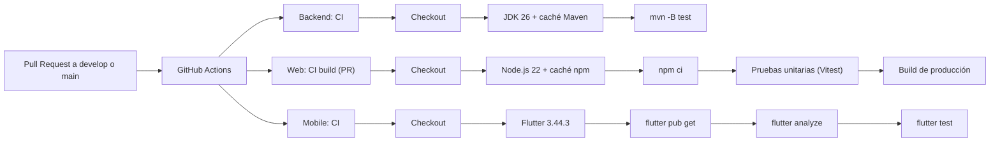
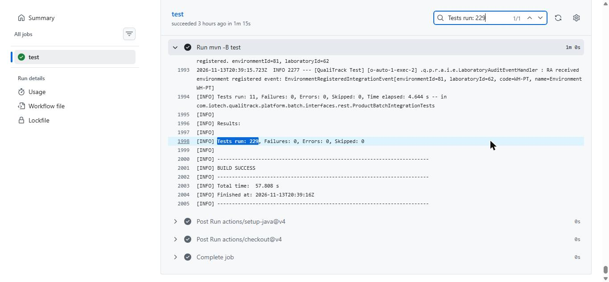
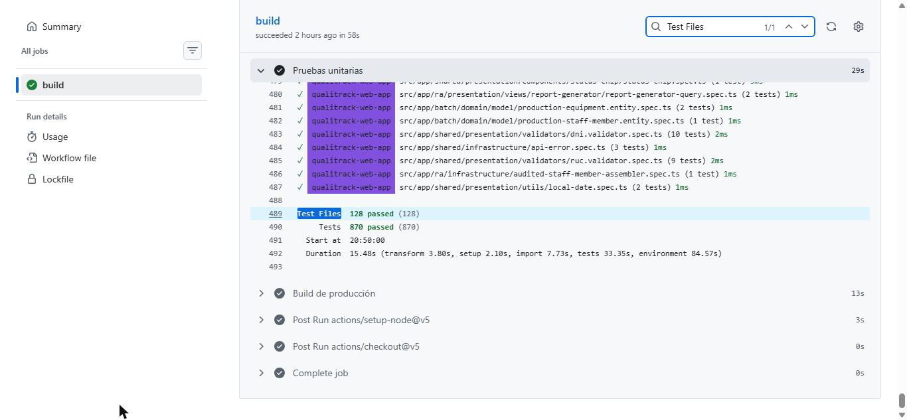
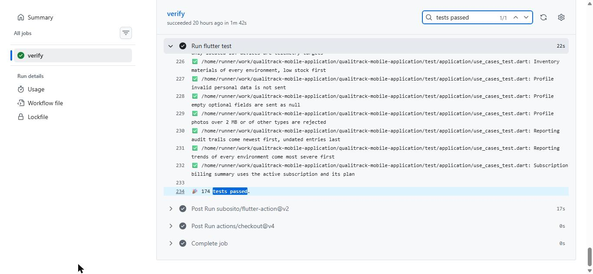

# Capítulo VII: DevOps Practices

### 7.1. Continuous Integration

En esta sección se describe cómo el equipo IoTech aplica la práctica de Integración Continua en QualiTrack. Cada Pull
Request hacia <code>develop</code> o <code>main</code> dispara de forma automática un pipeline en
<strong>GitHub Actions</strong> que instala las dependencias del producto, ejecuta su suite de pruebas y, en el caso de
la aplicación web, genera el build de producción. De esta manera, antes de aprobar el merge de un Pull Request, el
equipo verifica en el mismo Pull Request que los cambios compilan y que no rompen ninguna prueba existente.

Se implementó un pipeline de integración continua para cada uno de los productos de software:

| Producto | Repositorio | Workflow | Disparador | Qué valida |
|---|---|---|---|---|
| Backend Web Services | [Qualitrack-Platform](https://github.com/Experimentos-1ASI0732-2620-9104/Qualitrack-Platform) | `.github/workflows/ci.yml` | Pull Request hacia `develop` o `main` | Compilación y pruebas unitarias y de integración del API con Maven (229 pruebas). |
| Frontend Web Application | [Qualitrack-WebApplication](https://github.com/Experimentos-1ASI0732-2620-9104/Qualitrack-WebApplication) | `.github/workflows/ci-build.yml` | Pull Request hacia `develop` o `main` | Pruebas unitarias de Vitest (870 pruebas) y build de producción de Angular. |
| Mobile Application | [Qualitrack-MobileApplication](https://github.com/Experimentos-1ASI0732-2620-9104/Qualitrack-MobileApplication) | `.github/workflows/ci.yml` | Pull Request desde una rama `feature/*` hacia `develop` | Análisis estático con `flutter analyze` y pruebas de Flutter (174 pruebas). |

#### 7.1.1. Tools and Practices

Las herramientas utilizadas para implementar la integración continua son las siguientes:

| Herramienta | Uso en la integración continua |
|---|---|
| GitHub | Repositorios del proyecto y Pull Requests, organizados con el flujo GitFlow descrito en la sección 5.1.2. |
| GitHub Actions | Servidor de integración continua; ejecuta los workflows en máquinas virtuales `ubuntu-latest` en cada Pull Request. |
| Eclipse Temurin JDK 26 + caché de Maven | Entorno de Java usado para compilar y probar el backend (`actions/setup-java`). |
| Apache Maven | Gestión de dependencias, compilación y ejecución de pruebas (`mvn -B test`). |
| JUnit 5, Spring Boot Test y MockMvc | Suites de pruebas unitarias y de integración del backend (secciones 6.1.1 y 6.1.2). |
| Node.js 22 + caché de npm | Instalación reproducible de dependencias con `npm ci` (`actions/setup-node`). |
| Angular CLI + Vitest | Pruebas unitarias (`npm test -- --watch=false`) y build de producción (`npm run build`) de la aplicación web. |
| Flutter 3.44.3 (`subosito/flutter-action`) | Instalación de una versión fija de Flutter con caché, análisis estático y pruebas de la aplicación móvil. |

Las prácticas de integración continua que adopta el equipo son:

<ul>
  <li>
    <strong>Integración frecuente en un repositorio común:</strong> cada integrante trabaja en una rama
    <code>feature/*</code> creada desde <code>develop</code> y la integra mediante un Pull Request, siguiendo GitFlow y
    Conventional Commits.
  </li>
  <li>
    <strong>Build automatizado:</strong> la compilación no depende de la máquina de un integrante; el pipeline parte
    siempre de un entorno limpio e instala versiones fijas de las herramientas (JDK 26, Node.js 22 y Flutter 3.44.3).
    La versión de Flutter se fijó para que una nueva versión estable no haga fallar todos los Pull Requests.
  </li>
  <li>
    <strong>Build auto-verificable (self-testing build):</strong> el mismo pipeline ejecuta la suite de pruebas del
    producto; si alguna prueba falla, el pipeline termina en error. En la aplicación web las pruebas se ejecutan antes
    del build, y en la aplicación móvil el análisis estático se ejecuta antes de las pruebas.
  </li>
  <li>
    <strong>Retroalimentación rápida y visible:</strong> el resultado aparece en el Pull Request y en la pestaña
    <em>Actions</em> del repositorio. El pipeline del backend termina en alrededor de un minuto.
  </li>
  <li>
    <strong>Mínimos permisos:</strong> los workflows de integración declaran <code>permissions: contents: read</code>,
    por lo que solo pueden leer el código del repositorio.
  </li>
  <li>
    <strong>Corregir primero un build roto:</strong> un Pull Request con el pipeline en rojo no se integra hasta que el
    pipeline vuelva a estar en verde.
  </li>
</ul>

#### 7.1.2. Build & Test Suite Pipeline Components

El siguiente diagrama resume el flujo de integración continua de QualiTrack:

<strong>Pipeline del Backend Web Services</strong> (<code>Qualitrack-Platform/.github/workflows/ci.yml</code>, job
<em>test</em>):

| # | Componente (step) | Descripción |
|---|---|---|
| 1 | Trigger | Se ejecuta con cada Pull Request hacia `develop` o `main`. |
| 2 | Checkout | Descarga el código del commit que se va a validar (`actions/checkout@v4`). |
| 3 | Set up JDK 26 | Instala Eclipse Temurin JDK 26 y reutiliza la caché de dependencias de Maven (`actions/setup-java@v4`). |
| 4 | Test | Ejecuta `mvn -B test`: compila el proyecto y corre las pruebas unitarias y de integración. |

<strong>Pipeline de la Frontend Web Application</strong>
(<code>Qualitrack-WebApplication/.github/workflows/ci-build.yml</code>, job <em>build</em>):

| # | Componente (step) | Descripción |
|---|---|---|
| 1 | Trigger | Se ejecuta con cada Pull Request hacia `main` o `develop`. |
| 2 | Checkout | Descarga el código del commit (`actions/checkout@v5`). |
| 3 | Set up Node.js 22 | Instala Node.js 22 con caché de npm (`actions/setup-node@v5`). |
| 4 | Instalar dependencias | Instala exactamente las versiones del `package-lock.json` con `npm ci`. |
| 5 | Pruebas unitarias | Ejecuta `npm test -- --watch=false` (Vitest con Angular TestBed). |
| 6 | Build de producción | Compila la aplicación con `npm run build`; si hay errores de compilación, el pipeline se detiene. |

<strong>Pipeline de la Mobile Application</strong>
(<code>Qualitrack-MobileApplication/.github/workflows/ci.yml</code>, job <em>verify</em>):

| # | Componente (step) | Descripción |
|---|---|---|
| 1 | Trigger | Se ejecuta con cada Pull Request hacia `develop` cuya rama de origen empieza con `feature/`. |
| 2 | Checkout | Descarga el código del commit (`actions/checkout@v4`). |
| 3 | Set up Flutter | Instala Flutter 3.44.3 del canal estable con caché (`subosito/flutter-action@v2`). |
| 4 | Dependencias | Ejecuta `flutter pub get`. |
| 5 | Análisis estático | Ejecuta `flutter analyze` con las reglas de `analysis_options.yaml` (sección 6.2). |
| 6 | Pruebas | Ejecuta `flutter test`. |

<strong>Evidencia de ejecución:</strong>

| Pipeline | Resultado |
|---|---|
| Backend - CI | Exitoso en el Pull Request de la versión 1.2.0: 229 pruebas, 0 fallos, `BUILD SUCCESS` en aproximadamente 1 minuto. |
| Web - CI build (PR) | Exitoso en el Pull Request de la versión 2.5.0: 128 archivos y 870 pruebas de Vitest aprobados y build de producción generado. |
| Mobile - CI | Exitoso en el Pull Request de la rama `feature/refactor-ui`: `flutter analyze` sin observaciones y 174 pruebas aprobadas. |

  
  
<em>Figura: Workflow CI de Qualitrack-Platform en GitHub Actions.</em>

  
  
<em>Figura: Workflow CI build (PR) de Qualitrack-WebApplication en GitHub Actions.</em>

  
  
<em>Figura: Workflow CI de Qualitrack-MobileApplication en GitHub Actions.</em>

<strong>Commits relacionados con la integración continua:</strong>

| Repository | Branch | Commit Id | Commit Message | Committed on (Date) |
|---|---|---|---|---|
| Experimentos-1ASI0732-2620-9104/Qualitrack-Platform | feature/ci-cd-azure | 2bd3b4a | ci(test): run maven tests on pull requests to develop and main | 07/10/2026 |
| Experimentos-1ASI0732-2620-9104/Qualitrack-WebApplication | feature/ci-unit-tests | 50cce4c | ci: run the unit tests in the pull request build | 28/10/2026 |
| Experimentos-1ASI0732-2620-9104/Qualitrack-WebApplication | feature/ddd-import-check | 2c35598 | ci: check the DDD import rules in the pull request build | 28/10/2026 |
| Experimentos-1ASI0732-2620-9104/Qualitrack-WebApplication | chore/local-architecture-tools | 3b24e1a | chore: keep architecture checks local and remove tracked tools | 28/10/2026 |
| Experimentos-1ASI0732-2620-9104/Qualitrack-MobileApplication | feature/test-suite-and-ci | 6298942 | ci: run flutter analyze and test on feature pull requests into develop | 04/11/2026 |
| Experimentos-1ASI0732-2620-9104/Qualitrack-MobileApplication | feature/test-suite-and-ci | 0832913 | ci: remove the build and distribute APK workflow | 04/11/2026 |
| Experimentos-1ASI0732-2620-9104/Qualitrack-MobileApplication | feature/home-latest-alerts | 1d146f6 | ci: pin Flutter 3.44.3 so a new stable release does not fail every PR | 11/11/2026 |
