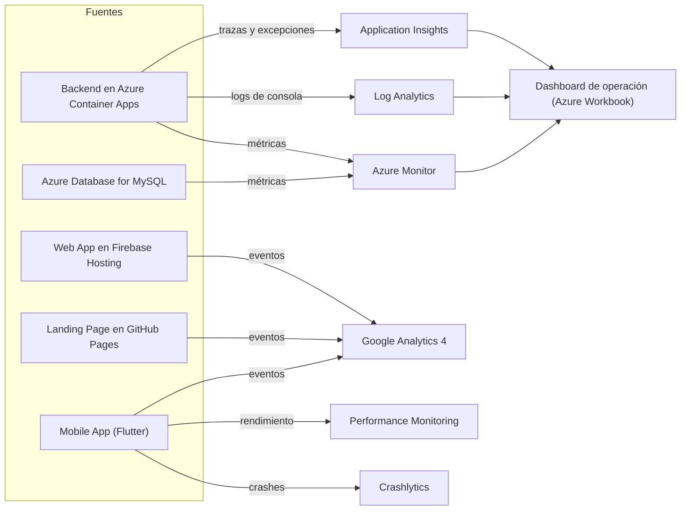
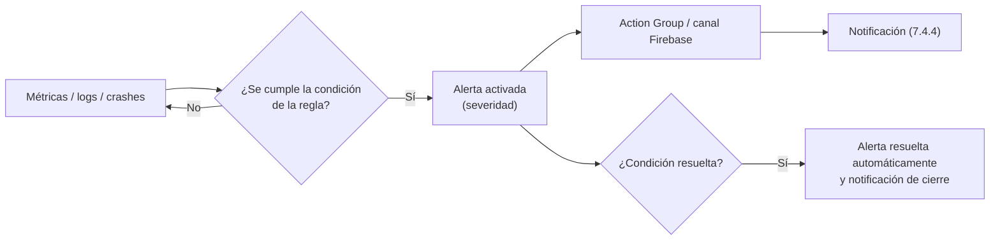

### 7.4. Continuous Monitoring

<p>
En esta sección se describe cómo el equipo IoTech aplica la práctica de Monitoreo Continuo sobre los productos
desplegados de QualiTrack. Una vez que el pipeline de despliegue continuo (sección 7.3) publica una nueva versión, el
monitoreo permite comprobar que la versión funciona correctamente en producción, detectar fallas antes de que las
reporten los usuarios y obtener los datos de uso necesarios para los experimentos del Capítulo VIII. El monitoreo se
organiza en tres partes: <strong>monitoring</strong> (recolección de métricas, logs y eventos), <strong>alerting</strong>
(reglas que detectan una condición anormal) y <strong>notification</strong> (envío del aviso a la persona responsable).
</p>

<p>
Productos monitoreados:
</p>

| Producto | Plataforma de ejecución | Fuente de monitoreo |
|---|---|---|
| Backend Web Services | Azure Container Apps (`iotech-qualitrack-api`) + Azure Database for MySQL | Azure Monitor, Log Analytics y Application Insights |
| Frontend Web Application | Firebase Hosting (`qualitrack-iotech`) | Google Analytics 4 (Firebase), Firebase Hosting usage |
| Landing Page | GitHub Pages | Google Analytics 4 |
| Mobile Application | APK generado con `flutter build apk` y distribuido de forma manual | Firebase Crashlytics, Firebase Performance Monitoring y Google Analytics for Firebase |
| Pipelines | GitHub Actions | Historial de ejecuciones y notificaciones de GitHub |

<p>
<strong>Estado de implementación:</strong> en cada tabla se indica si el componente ya está disponible en la plataforma
de despliegue actual o si corresponde a configuración que se incorpora en el Sprint del Avance 2. A la fecha de este
avance, los repositorios no incluyen todavía dependencias de instrumentación (Spring Boot Actuator, SDK de Application
Insights, Firebase Analytics o Crashlytics), por lo que esos componentes se registran como <em>Por implementar</em> y se
trazan con las historias técnicas del To-Be Product Backlog (sección 8.3.2).
</p>

#### 7.4.1. Tools and Practices

| Herramienta | Uso en el monitoreo continuo | Estado |
|---|---|---|
| Azure Monitor (métricas de Container Apps) | Métricas de plataforma del backend: solicitudes, códigos de respuesta, uso de CPU y memoria, réplicas y reinicios. | Disponible en la plataforma |
| Azure Log Analytics | Consulta con KQL de los logs de consola de la aplicación (`ContainerAppConsoleLogs_CL`) y de sistema (`ContainerAppSystemLogs_CL`). | Por verificar en el entorno de Container Apps |
| Spring Boot Actuator | Expone `/actuator/health` (liveness y readiness, incluyendo el estado de la conexión a MySQL) y `/actuator/metrics` para el backend. | Por implementar |
| Azure Application Insights (agente Java) | Trazas distribuidas, tiempos de respuesta por endpoint, dependencias (MySQL, Stripe) y excepciones del backend, sin cambios de código. | Por implementar |
| Application Insights - Availability tests | Prueba de disponibilidad cada 5 minutos desde varias regiones contra el health check del API, la web y la landing page. | Por implementar |
| Azure Database for MySQL - métricas | CPU, conexiones activas, almacenamiento y consultas lentas de la base de datos de producción. | Disponible en la plataforma |
| Google Analytics 4 | Eventos de navegación y de negocio de la landing page y de la aplicación web, usados por el Web Tracking Plan (sección 8.2.8). | Por implementar |
| Firebase Crashlytics | Reporte de cierres inesperados y errores no controlados de la aplicación móvil, agrupados por versión. | Por implementar |
| Firebase Performance Monitoring | Tiempo de arranque de la app y duración de las solicitudes HTTP al API desde el móvil. | Por implementar |
| Azure Monitor Alerts + Action Groups | Reglas de alerta sobre métricas y logs del backend y canales de notificación. | Por implementar |
| GitHub Actions | Historial y estado de cada pipeline de CI/CD; notificación por correo al autor cuando un workflow falla. | Implementado |

<p>
Las prácticas de monitoreo continuo que adopta el equipo son:
</p>

<ul>
  <li>
    <strong>Monitorear lo que importa al usuario:</strong> se priorizan indicadores observables por los usuarios
    (disponibilidad, tiempo de respuesta y errores) sobre métricas internas de infraestructura.
  </li>
  <li>
    <strong>Objetivos de nivel de servicio (SLO):</strong> disponibilidad mensual del API de 99.5 %, percentil 95 del tiempo
    de respuesta menor a 800 ms y tasa de respuestas 5xx menor a 1 %.
  </li>
  <li>
    <strong>Health checks como contrato del despliegue:</strong> Azure Container Apps usa las probes de liveness y
    readiness para no enviar tráfico a una revisión que no está lista, y al pipeline de la sección 7.3 se le agrega un
    paso final que consulta el health check después de desplegar.
  </li>
  <li>
    <strong>Logs estructurados y sin datos sensibles:</strong> los logs incluyen el identificador de la solicitud y del
    laboratorio, pero nunca contraseñas, tokens JWT ni datos de pago.
  </li>
  <li>
    <strong>Monitoreo por versión:</strong> cada revisión de Container Apps y cada build de la app móvil se identifica
    con el SHA del commit o la versión semántica, lo que permite relacionar una falla con el release que la introdujo y
    hacer rollback (sección 7.3).
  </li>
  <li>
    <strong>Alertas accionables:</strong> solo se crean alertas que requieren una acción; cada alerta indica su severidad,
    el responsable y el procedimiento a seguir, para evitar fatiga por alertas.
  </li>
</ul>

#### 7.4.2. Monitoring Pipeline Components



| # | Componente | Descripción | Métricas / datos recolectados |
|---|---|---|---|
| 1 | Health check del backend | Endpoint `/actuator/health` con indicadores de liveness, readiness y base de datos. | Estado `UP` / `DOWN` del API y de MySQL. |
| 2 | Métricas de Container Apps | Recolectadas automáticamente por Azure Monitor para la aplicación `iotech-qualitrack-api`. | `Requests`, códigos 2xx/4xx/5xx, `CpuUsage`, `MemoryWorkingSetBytes`, `Replicas`, `RestartCount`. |
| 3 | Logs de aplicación | Salida de consola de Spring Boot enviada al workspace de Log Analytics. | Errores, excepciones, advertencias de seguridad (inicios de sesión fallidos) y eventos de negocio. |
| 4 | Telemetría de Application Insights | Agente Java de Application Insights configurado con la variable `APPLICATIONINSIGHTS_CONNECTION_STRING`. | Duración por endpoint (p50, p95), dependencias, excepciones y trazas por solicitud. |
| 5 | Métricas de base de datos | Azure Database for MySQL - Servidor flexible. | `cpu_percent`, `active_connections`, `storage_percent`, consultas lentas. |
| 6 | Pruebas de disponibilidad | Availability tests de Application Insights. | Disponibilidad y latencia del API, de la web y de la landing page desde varias regiones. |
| 7 | Analítica web | Google Analytics 4 en la landing page y en la aplicación web. | Usuarios, sesiones, páginas vistas y eventos del tracking plan (sección 8.2.8). |
| 8 | Monitoreo móvil | Firebase Crashlytics, Performance Monitoring y Analytics en la app Flutter. | Usuarios sin fallas, cierres por versión, tiempo de arranque, latencia HTTP y eventos del tracking plan. |
| 9 | Dashboard de operación | Azure Workbook que reúne disponibilidad, errores, latencia y uso de recursos del backend. | Vista única para la revisión diaria y para el Sprint Review. |

<p>
Ejemplo de consulta KQL utilizada en el dashboard para identificar los endpoints con más errores en la última hora:
</p>

```kusto
requests
| where timestamp > ago(1h)
| summarize total = count(), errors = countif(toint(resultCode) >= 500),
            p95 = percentile(duration, 95) by name
| extend errorRate = round(100.0 * errors / total, 2)
| order by errors desc
```

#### 7.4.3. Alerting Pipeline Components

<p>
Las reglas de alerta se definen en Azure Monitor (backend y base de datos) y en Firebase (aplicación móvil). Cada regla
tiene una severidad que determina el canal de notificación de la sección 7.4.4.
</p>

| # | Regla de alerta | Fuente | Condición | Ventana | Severidad |
|---|---|---|---|---|---|
| 1 | API no disponible | Availability test | Falla en 2 o más ubicaciones | 5 min | Sev 0 - Crítica |
| 2 | Errores 5xx elevados | Container Apps / App Insights | Tasa de respuestas 5xx > 5 % | 5 min | Sev 1 - Alta |
| 3 | Latencia degradada | Application Insights | p95 del tiempo de respuesta > 2 s | 10 min | Sev 2 - Media |
| 4 | Reinicios del contenedor | Container Apps | `RestartCount` > 2 | 15 min | Sev 1 - Alta |
| 5 | CPU del backend alta | Container Apps | `CpuUsage` > 80 % | 15 min | Sev 2 - Media |
| 6 | Base de datos saturada | Azure Database for MySQL | `cpu_percent` > 85 % o `active_connections` > 80 % del máximo | 15 min | Sev 2 - Media |
| 7 | Excepciones no controladas | Log Analytics | Más de 10 excepciones `ERROR` | 10 min | Sev 2 - Media |
| 8 | Intentos de inicio de sesión fallidos | Log Analytics | Más de 20 respuestas 401 desde una misma IP | 5 min | Sev 1 - Alta |
| 9 | Aumento de cierres en la app móvil | Firebase Crashlytics (velocity alert) | Un mismo error afecta a más del 1 % de usuarios de una versión | 1 h | Sev 1 - Alta |
| 10 | Pipeline fallido | GitHub Actions | Un workflow de `main` o `develop` termina en error | Por ejecución | Sev 2 - Media |



#### 7.4.4. Notification Pipeline Components

<p>
Cada alerta se envía a un canal según su severidad. Los canales se configuran en un Action Group de Azure Monitor
(<code>ag-qualitrack-oncall</code>) y en la configuración de alertas de Firebase y GitHub.
</p>

| Severidad | Canal de notificación | Destinatarios | Tiempo de respuesta esperado |
|---|---|---|---|
| Sev 0 - Crítica | Correo + mensaje en el canal `#qualitrack-alerts` del equipo (webhook) + notificación push de la app Azure | Responsable de despliegue del sprint y líder del equipo | 15 minutos |
| Sev 1 - Alta | Correo + mensaje en `#qualitrack-alerts` | Responsable del producto afectado | 1 hora |
| Sev 2 - Media | Mensaje en `#qualitrack-alerts` | Todo el equipo | Siguiente jornada de trabajo |
| Pipeline fallido | Correo de GitHub al autor del commit + estado en el Pull Request | Autor del cambio | Antes del siguiente merge |

<p>
Flujo de atención de una notificación:
</p>

| # | Paso | Descripción |
|---|---|---|
| 1 | Recepción | El responsable recibe la notificación con el nombre de la regla, la severidad, el valor medido y el enlace al recurso en Azure Portal o Firebase Console. |
| 2 | Reconocimiento | El responsable confirma en el canal del equipo que está atendiendo la alerta, para evitar trabajo duplicado. |
| 3 | Diagnóstico | Revisa el dashboard de operación, las consultas de Log Analytics y la revisión activa de Container Apps. |
| 4 | Mitigación | Si la falla proviene del último release, activa la revisión anterior de Container Apps o el release anterior de Firebase Hosting (rollback, sección 7.3); si no, aplica un `hotfix/*` siguiendo GitFlow. |
| 5 | Cierre y aprendizaje | Cuando la alerta se resuelve, se registra un resumen (causa, impacto, acción) que se revisa en la retrospectiva del sprint. |
